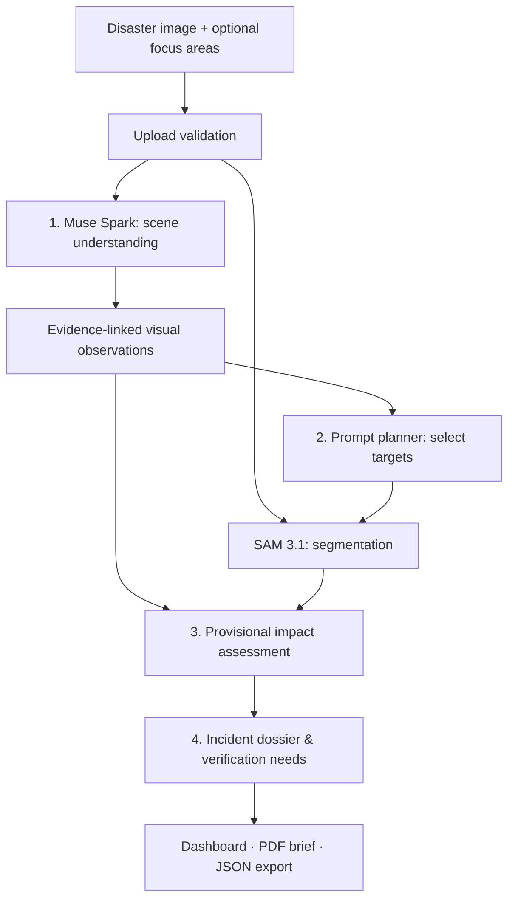

# Himalayan Sentinel

### AI-assisted disaster image analysis, visual evidence, and incident reporting

*Meta Global AI Developer Hackathon · Indie Developer Track*

**Himalayan Sentinel** turns a disaster photograph into a structured, evidence-linked incident report. Designed with Himalayan flood and landslide scenarios in mind, it helps a human reviewer identify visible hazards, inspect potentially affected infrastructure, examine segmented objects, and prioritize what needs verification on the ground.

The system combines **Meta Muse Spark** for scene understanding and **Meta SAM 3.1** for visual segmentation, followed by evidence-aware impact assessment and report generation. Its goal is not to make definitive emergency decisions, but to make complex imagery **easier to inspect, explain, and act on responsibly**.

> **Human-in-the-loop by design:** Findings are provisional and may be incomplete. Himalayan Sentinel does not predict disasters, confirm structural safety, issue evacuation orders, or dispatch rescue teams. Operational conclusions require qualified human verification.

## What it does

| Capability | What the reviewer gets |
| --- | --- |
| **Scene understanding** | Descriptions of visible hazards, people, infrastructure, image-relative locations, and uncertainty. |
| **Interactive segmentation** | SAM-generated masks and bounding boxes for relevant objects, with optional user-selected focus areas. |
| **Provisional impact assessment** | Evidence-linked concerns about infrastructure condition, access, and human safety—without treating proximity to a hazard as confirmed damage. |
| **Verification priorities** | Specific questions and follow-up checks for a human reviewer, rather than unsupported definitive conclusions. |
| **Incident reporting** | A readable incident dossier, a print-ready/PDF brief, and a structured JSON export with technical provenance. |
| **Graceful partial results** | Available observations remain visible if segmentation has zero matches, is skipped, or fails. |

### A typical workflow

1. **Upload an image** — JPEG, PNG, or WebP, up to **5 MiB**; optionally choose up to three focus areas.
2. **Review visual observations** — Muse Spark describes what appears in the scene and where, with explicit uncertainties.
3. **Inspect segmentation overlays** — SAM 3.1 highlights candidate regions for selected concepts. Masks are visual aids, not validated hazard or damage boundaries.
4. **Examine provisional impacts** — The system separates directly observed conditions from possible consequences and unknowns.
5. **Generate an incident report** — Review recommended verification actions, then print/save a PDF brief or export JSON.

The report workflow can reuse analysis cached for the current session, avoiding additional model calls when an eligible analysis is already available.

## How it works

Himalayan Sentinel uses a **four-stage, in-process pipeline** orchestrated by a single FastAPI backend—no separate agent servers or autonomous external actions.



| Stage | Implementation | Purpose |
| --- | --- | --- |
| **1 · Scene understanding** | `backend/app/agents/vision_agent.py` | Uses `muse-spark-1.3` to produce structured observations, supported locations, and uncertainty notes. |
| **2 · Visual segmentation** | `backend/app/services/prompt_planner.py`, `sam31_client.py` | Selects up to **three** prompts, prioritizing user focus areas before relevant observed concepts; processes SAM masks and boxes. |
| **3 · Impact assessment** | `backend/app/agents/impact_agent.py`, `condition_assessment.py` | Evaluates visible hazards, conditional exposure concerns, provisional damage, and human-review priorities. |
| **4 · Incident reporting** | `backend/app/agents/reporting_agent.py`, `report_content.py` | Assembles a readable dossier with evidence references, uncertainties, information gaps, and verification actions. |

The orchestration and validation code in `backend/app/orchestrator/` checks evidence references, assessment support, and partial-result handling before presenting a dossier. The React frontend renders the annotated image, analysis summary, verification workflow, and exports.

### Why combine Muse Spark and SAM?

- **Muse Spark explains the scene:** It identifies what may be happening and describes visible conditions, such as floodwater around buildings or debris on a road.
- **SAM localizes candidate objects:** It returns geometric masks and bounding boxes for prompts such as `people`, `road`, `building`, or operator-specified components such as `roof`.
- **The assessment layer keeps those roles separate:** A mask is **not** proof of structural damage, exact inundation extent, or physical contact between objects. Findings and segmentation are interpreted conservatively, with explicit human verification needs.

Both models are called from the backend through the Meta Model API (`POST /responses`). The API key is kept server-side in `MODEL_API_KEY`; it is not sent to the browser. Model requests have bounded timeouts, and the unified analysis has a default **90-second** workflow budget.

For protocol and parsing details, see [Meta Integration Notes](docs/meta-integration.md) and the [API Contract](docs/api-contract.md).

## Technology stack

| Area | Technology |
| --- | --- |
| Frontend | React 18, TypeScript, Vite, Tailwind CSS; Leaflet is included in the project |
| Backend | Python 3.11+, FastAPI, Pydantic v2, HTTPX, Pillow |
| AI models | Meta Muse Spark 1.3 and SAM 3.1 via the Meta Model API |
| Segmentation output | Bounding boxes, SVG paths, COCO RLE masks |
| Testing | pytest with mocked model clients; frontend test/render checks |
| Reporting | In-app dossier, browser print/PDF, structured JSON |

## Run locally

The commands below use **Windows PowerShell**. Run the backend and frontend in separate terminals, starting from the cloned repository's root directory.

**Prerequisites:** Python **3.11+**, Node.js **20+**, npm, and a Meta Model API key with access to the models for live analysis. The interface can start without a key, but model-backed analysis cannot run successfully.

### 1. Start the backend

```powershell
cd backend
python -m venv .venv
.\.venv\Scripts\python.exe -m pip install -r requirements.txt
Copy-Item .env.example .env
```

Open `backend/.env` and set your credential:

```dotenv
MODEL_API_KEY=your_meta_model_api_key
```

Then start FastAPI:

```powershell
.\.venv\Scripts\python.exe -m uvicorn app.main:app --reload --port 8000
```

Check the API at **http://localhost:8000/api/health**.

### 2. Start the frontend

In a **second terminal**, from the repository root:

```powershell
cd frontend
npm install
npm run dev
```

Open **http://localhost:5173**. The Vite development server proxies `/api` requests to port `8000`.

### 3. Try the demo

1. Open **Analyze Image** and upload a disaster photo (up to **5 MiB**).
2. Optionally add focus areas such as `people`, `building`, `road`, `debris`, or `roof`.
3. Start analysis; review **Visual Observation 1**, **Visual Observation 2**, and subsequent findings alongside the SAM overlays.
4. Open **Incident Reports** to prepare a dossier from the current analysis.
5. Check the **Analysis Summary**, provisional infrastructure assessments, information gaps, and **Verification** checklist.
6. Use **Print Brief** to print/save as PDF, or **Download JSON** to inspect the full structured evidence record.

**No disaster photographs are bundled.** Use imagery you own or are permitted to use and redistribute for your demonstration. See the [Demo Guide](docs/demo.md) for the guided presentation flow.

### Production build

```powershell
cd frontend
npm run build
```

The output is written to `frontend/dist/`. For deployment, provide a reachable FastAPI backend and configure the frontend API base URL and backend CORS settings appropriately (see `frontend/.env.example` and `backend/.env.example`). A production build alone does not deploy the backend.

## Testing

Automated tests use mocked model integrations; they do **not** require paid live Meta API calls.

From the repository root, run backend tests:

```powershell
cd backend
.\.venv\Scripts\python.exe -m pytest tests/ -q
```

In a separate terminal, from the repository root, run frontend checks and build:

```powershell
cd frontend
npm test
npm run build
```

A live end-to-end demonstration separately requires a valid Meta API key, network access, and an image upload. Results can vary with model responses and image conditions.

## Responsible use and known limitations

Himalayan Sentinel is **decision support**, not a certified hazard-monitoring, damage-inspection, or emergency-dispatch system.

- **Visible evidence is not a damage certificate.** Inundation, burial, and obstruction do not by themselves confirm structural failure; preliminary damage assessments are not engineering findings.
- **Segmentation can be incomplete.** SAM may miss submerged or partially obscured objects. A zero-match result does not prove an object is absent; masks do not establish precise disaster boundaries.
- **Assessments are provisional.** Impact categories are evaluated at an infrastructure-family level rather than as verified assessments of every individual asset.
- **People-related priorities need context.** The system does not infer injury, entrapment, or immediate rescue need merely because people are visible.
- **Confidence is uncalibrated.** Model confidence signals are not validated probabilities or grounds for public alerts.
- **Location and time may be unknown.** Image-relative positions are not map coordinates; operator-supplied location is treated as unverified.
- **Partial results are explicit.** Skipped or failed model steps are surfaced rather than silently treated as successful processing.

All high-stakes interpretation and operational decisions remain with trained reviewers and the appropriate authorities. See the [Evidence Model](docs/evidence-model.md) for traceability and confidence conventions.

## Current scope

| Capability | Status |
| --- | --- |
| Image-based scene analysis and SAM segmentation | **Implemented** |
| Provisional impact assessment and human-review priorities | **Implemented** |
| Incident dossier, verification checklist, PDF/JSON exports | **Implemented** |
| Session-based analysis reuse | **Implemented** |
| Historical comparison, monitoring, hydrometeorological context | **Planned** |
| Legacy assessment and map/GeoIntel workflows | Scaffold placeholders; outside the main workflow |
| Persistent incident history and database-backed review workflow | **Not implemented** |
| Video analysis and automatic disaster prediction | **Not implemented** |

The repository includes some schemas and scaffolding for future work. These should not be interpreted as completed features. See [Future Work](docs/future-work.md).

## Repository guide

```text
backend/
  app/
    agents/           Scene understanding, impact assessment, reporting
    api/              FastAPI routes
    core/             Configuration and shared utilities
    orchestrator/     Workflow coordination and validation
    schemas/          API and evidence contracts
    services/         Meta clients, media processing, prompt planning
  tests/              Mocked integration and regression tests
frontend/
  src/                React pages, components, UI, report export
docs/                Architecture, API, evidence, demo, integration notes
README.md
LICENSE
```

**Technical documentation**

- [Architecture](docs/architecture.md) — components, orchestration, and boundaries
- [API Contract](docs/api-contract.md) — implemented endpoints, payloads, and error behavior
- [Evidence Model](docs/evidence-model.md) — traceability, confidence, and review states
- [Demo Guide](docs/demo.md) — suggested presentation and export walkthrough
- [Meta Integration Notes](docs/meta-integration.md) — API wiring and SAM output parsing
- [Future Work](docs/future-work.md) — limitations and deferred engineering work

## License

MIT — see [LICENSE](LICENSE). Meta models, APIs, and other third-party components are governed by their own applicable terms. No third-party disaster images are distributed in this repository.
